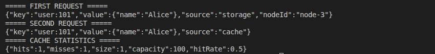

# GMC Distributed Key-Value Store with Consistent Hashing and Caching

A distributed key-value storage system built with Node.js. The project demonstrates consistent hashing, dynamic node membership, data migration, LRU caching, and limited availability during storage-node failures.

## 1. Project Overview

The system distributes key-value records across multiple independent storage nodes using a consistent hashing algorithm.

A central gateway handles client requests and hides the underlying storage-node complexity. It determines which node owns a key, forwards requests, and uses an LRU cache to improve read performance.

### Main Features

- **Consistent hashing:** Distributes keys across storage nodes using a hash ring with virtual nodes.
- **Dynamic node membership:** Supports adding and removing storage nodes.
- **Data migration:** Moves records to their new owners when the hash-ring membership changes.
- **LRU caching:** Stores frequently accessed values to reduce repeated storage requests.
- **Failure simulation:** Demonstrates how healthy nodes continue serving requests when another node becomes unavailable.
- **Transparency:** Clients interact with a single gateway API rather than communicating with individual storage nodes.

## 2. Architecture

The project uses two main components:

- **Gateway:** Receives client requests, manages the hash ring, routes operations, and handles caching.
- **Storage nodes:** Independently store and retrieve key-value records through HTTP endpoints.

```text
                  Client
                    |
                    v
             Gateway (Port 3000)
                    |
          +---------+---------+
          |         |         |
          v         v         v
       Node 1    Node 2    Node 3
       :3001     :3002     :3003
```

The gateway uses consistent hashing to determine the destination node for each key.

See [Architecture Documentation](docs/architecture.md) for further details.

## 3. Technologies

- Node.js
- JavaScript (ES Modules)
- HTTP
- Node.js built-in testing framework
- SHA-256 hashing
- LRU caching
- Git and GitHub

No external npm dependencies are required.

## 4. Project Structure

```text
GMC-Distributed-Key-Value-Store/
├── src/
│   ├── gateway/
│   │   ├── gateway.js
│   │   ├── hashRing.js
│   │   └── cache.js
│   └── node/
│       ├── server.js
│       └── storageNode.js
├── tests/
│   ├── cache.test.js
│   ├── gateway.test.js
│   ├── hashRing.test.js
│   └── storageNode.test.js
├── screenshots/
├── docs/
│   └── architecture.md
├── .gitignore
├── package.json
└── README.md
```

## 5. Installation and Setup

### Requirements

- Node.js 18 or later
- npm

Clone the repository:

```bash
git clone https://github.com/KatiaGhezali/GMC-Distributed-Key-Value-Store.git
cd GMC-Distributed-Key-Value-Store
```

No additional npm packages need to be installed.

### Start the Storage Nodes

Open three separate terminals.

Terminal 1:

```bash
NODE_ID=node-1 NODE_PORT=3001 node src/node/server.js
```

Terminal 2:

```bash
NODE_ID=node-2 NODE_PORT=3002 node src/node/server.js
```

Terminal 3:

```bash
NODE_ID=node-3 NODE_PORT=3003 node src/node/server.js
```

### Start the Gateway

Open a fourth terminal:

```bash
STORAGE_NODES="node-1=http://localhost:3001,node-2=http://localhost:3002,node-3=http://localhost:3003" node src/gateway/gateway.js
```

The gateway listens on port `3000`.

Clients can now interact with the distributed system through the gateway.

## 6. API Endpoints

| Method | Endpoint             | Description                   |
| ------ | -------------------- | ----------------------------- |
| GET    | `/health`            | Gateway health check          |
| GET    | `/api/nodes`         | List registered storage nodes |
| POST   | `/api/nodes`         | Register a new storage node   |
| DELETE | `/api/nodes/:nodeId` | Remove a storage node         |
| GET    | `/api/data?key=KEY`  | Retrieve a value              |
| PUT    | `/api/data?key=KEY`  | Store or update a value       |
| DELETE | `/api/data?key=KEY`  | Delete a value                |
| GET    | `/api/cache/stats`   | Retrieve cache statistics     |

### Example: Store a Value

```bash
curl -X PUT "http://localhost:3000/api/data?key=user:101" \
  -H "Content-Type: application/json" \
  -d '{"value":{"name":"Alice"}}'
```

### Example: Retrieve a Value

```bash
curl "http://localhost:3000/api/data?key=user:101"
```

The response includes the key, its value, and whether the result came from storage or the cache.

## 7. Sample Dataset

The project uses the six records provided in the checkpoint:

| Key      | Value   |
| -------- | ------- |
| user:101 | Alice   |
| user:102 | Bob     |
| user:103 | Charlie |
| user:104 | Diana   |
| user:105 | Eve     |
| user:106 | Frank   |

The initial distribution across three storage nodes was:

| Storage Node | Records         |
| ------------ | --------------- |
| Node 1       | Bob, Eve, Frank |
| Node 2       | Charlie, Diana  |
| Node 3       | Alice           |

The distribution is determined by the consistent hashing algorithm.

## 8. Consistent Hashing and Data Migration

The hash ring uses SHA-256 hashing and 100 virtual nodes per physical storage node.

When a key is inserted or retrieved, the gateway calculates its hash and selects the next available position on the ring.

When a node joins or leaves, the gateway recalculates key ownership and migrates records whose destination changes.

The implementation also uses migration snapshots and rollback procedures to reduce the risk of losing records if a migration operation fails.

### Key Movement Results

The consistent hashing tests evaluated 1,000 keys.

| Operation     |  Keys Moved | Percentage |
| ------------- | ----------: | ---------: |
| Add node-4    | 232 / 1,000 |     23.20% |
| Remove node-4 | 232 / 1,000 |     23.20% |

These results demonstrate that consistent hashing limits the number of keys requiring reassignment when the cluster membership changes.

## 9. LRU Cache

The gateway implements a Least Recently Used (LRU) cache with a default capacity of 100 entries.

Frequently accessed values are retained in memory. When the cache reaches capacity, the least recently accessed entry is evicted.

The cache exposes statistics including:

- Cache hits
- Cache misses
- Current cache size
- Maximum capacity
- Hit rate

### Cache Test Results

A cold-cache test produced the following results:

| Request                 | Source  |
| ----------------------- | ------- |
| First read of user:101  | Storage |
| Second read of user:101 | Cache   |

Cache statistics:

- Hits: 1
- Misses: 1
- Hit rate: 50%

## 10. Node Failure Simulation

The project simulates a storage-node failure by stopping one of the running storage-node processes.

During testing, node-3 was stopped.

Results:

| Request                               | Result   |
| ------------------------------------- | -------- |
| Retrieve user:101 from failed node-3  | HTTP 503 |
| Retrieve user:102 from healthy node-1 | HTTP 200 |

The gateway continued serving requests assigned to healthy nodes even while node-3 was unavailable.

Previously cached values could also remain accessible without contacting the failed storage node.

This demonstrates limited availability rather than full fault tolerance.

## 11. Running the Tests

Run the complete test suite:

```bash
npm test
```

The tests cover:

- Cache storage, retrieval, eviction, and statistics.
- Consistent hashing and node membership.
- Minimal key movement during node joins and removals.
- Storage-node HTTP operations.
- Gateway integration, migration, caching, and failure handling.

**Final test result: 15 tests passed, 0 failed.**

## 12. Screenshots

### Storage Node Distribution

Shows the six sample records physically distributed across three storage nodes.


### Cache Hit and Miss

Shows the first read served from storage and the second read served from the cache.



### Node Failure and Limited Availability

Shows the failed node returning HTTP 503 while a healthy node continues returning HTTP 200.


## 13. Limitations and Future Improvements

This project is an educational simulation and has several limitations:

- **In-memory storage:** Records are lost when a storage-node process stops.
- **No replication:** Each key has one assigned storage owner, so records on a failed node are temporarily unavailable unless they are cached.
- **No persistent database:** Data is not saved to disk.
- **No authentication:** The demonstration API does not implement client authentication or authorization.
- **No automatic recovery:** A restarted storage node does not automatically recover its previous data.
- **Single gateway:** The gateway itself is not replicated.

Potential future improvements include persistent storage, replication, automatic failure detection, recovery mechanisms, and gateway redundancy.

## 14. Conclusion

This project demonstrates the fundamental principles of a distributed key-value storage system through consistent hashing, dynamic node membership, data migration, LRU caching, and simulated node failures.

The implementation successfully demonstrates data distribution, reduced key movement, cache performance, and limited availability while keeping the client interface independent of the underlying storage nodes.
